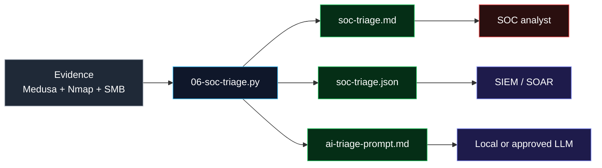

# Cybersecurity Lab: Medusa, SOC and AI Automation

**DIO challenge:** implementing a brute-force attack with Medusa in an isolated lab.

[🇧🇷 Português](README.md) · **English**


[](https://github.com/isaacof/dio-medusa-bruteforce-lab/actions/workflows/ci.yml)


> **Educational project in an isolated environment.**
> All tests were performed against my own virtual machines (Metasploitable 2 and DVWA) on a **host-only** network, with no internet exposure and no real targets. Use these techniques only with **written authorization**.

---

## For recruiters

A hands-on project connecting **authorized offensive security**, **SOC operations** and **automation**:

- **SOC / Blue Team:** log analysis, triage, **MITRE ATT&CK** mapping and detection rules (Sigma, SPL, KQL, Wazuh).
- **Pentest lab:** Nmap reconnaissance, SMB enumeration, brute force and password spraying with Medusa.
- **Python automation:** normalizes evidence and generates a Markdown report, SIEM-ready JSON and a sanitized AI prompt.
- **Engineering:** 8 technical guides, reproducible scripts, GitHub Actions CI and real evidence.

> Everything comes from an isolated lab. No real credentials or third-party data were used.

---

## What the lab demonstrates

| Area | Evidence |
|---|---|
| Reconnaissance | Nmap, enum4linux, smbclient |
| Credential attacks | Medusa modules `ftp`, `smbnt` and `web-form` |
| Validation | Independent checks with `curl` and `smbclient` |
| SOC triage | [`reports/soc-triage.md`](reports/soc-triage.md) and [`reports/soc-triage.json`](reports/soc-triage.json) |
| Detection engineering | [`detections/`](detections/) with Sigma and Wazuh rules |
| AI-assisted analysis | [`reports/ai-triage-prompt.md`](reports/ai-triage-prompt.md) with guardrails |
| Automation / CI | [`scripts/06-soc-triage.py`](scripts/06-soc-triage.py) and [`.github/workflows/ci.yml`](.github/workflows/ci.yml) |

---

## Results

| Vector | Service | Technique | Credential | Attempts | Validation |
|---|---|---|---:|---:|---|
| FTP | vsftpd 2.3.4 | Brute force | `msfadmin:msfadmin` | 16 | `curl ftp://...` listed `vulnerable` |
| SMB | Samba 3.0.20 | Enumeration + spraying | `msfadmin:msfadmin` | 1 | `smbclient` listed `/tmp`; `ADMIN$` allowed |
| Web | DVWA | Web form brute force | `admin:password` | 1 | Page returned “Welcome...” |

**Lab numbers:** 9 open ports, 35 SMB users, 5 shares, 3 compromised services, ~1 minute from first attack to last valid access.

> The credentials above are **public defaults of intentionally vulnerable lab VMs**. They are not real-world secrets.

---

## From attack to detection



The Python script:

1. parses `ACCOUNT FOUND` events from Medusa logs;
2. classifies technique and severity;
3. maps findings to **MITRE ATT&CK** (`T1110.001`, `T1110.003`, `T1078`);
4. enriches with Nmap and SMB enumeration;
5. **redacts credentials by default**;
6. generates Markdown, JSON and a sanitized AI prompt.

```bash
python3 scripts/06-soc-triage.py --source evidencias --out reports
python3 scripts/07-validar-links.py
python3 -m unittest discover -s tests -v
```

Optional local AI run with Ollama (no data leaves the machine):

```bash
ollama pull llama3.2
./scripts/08-ai-triage.sh
```

---

## Repository map

```text
.
├── .github/workflows/ci.yml
├── detections/            Sigma and Wazuh rules
├── docs/                  8 technical guides + index
├── evidencias/            Nmap, FTP, SMB, DVWA logs and screenshots
├── reports/               SOC report, JSON and AI prompt
├── scripts/               attack scripts + SOC automation
├── tests/                 unit and integration tests
├── wordlists/             small lab-only wordlists
├── Makefile
└── SECURITY.md
```

---

## Documentation

- [01 — Lab setup](docs/01-ambiente.md)
- [02 — Reconnaissance](docs/02-reconhecimento.md)
- [03 — FTP](docs/03-ftp.md)
- [04 — SMB](docs/04-smb.md)
- [05 — DVWA](docs/05-dvwa.md)
- [06 — Mitigations](docs/06-mitigacoes.md)
- [07 — Conclusion](docs/07-conclusao.md)
- [08 — SOC and AI automation](docs/08-soc-e-automacao.md)

Full index: [`docs/README.md`](docs/README.md).

---

## Reproduce safely

Prerequisites: VirtualBox host-only network `192.168.56.0/24`, Kali Linux at `192.168.56.101`, Metasploitable 2 at `192.168.56.102` with DVWA.

```bash
sudo apt install -y medusa nmap enum4linux smbclient curl
git clone https://github.com/isaacof/dio-medusa-bruteforce-lab.git
cd dio-medusa-bruteforce-lab
chmod +x scripts/*.sh
./scripts/00-verificar-ambiente.sh
./scripts/01-reconhecimento.sh
./scripts/02-ftp-medusa.sh
./scripts/03-smb-enum.sh
./scripts/04-smb-medusa.sh
./scripts/05-dvwa-medusa.sh
./scripts/99-validar-acessos.sh
```

> ⚠️ Use only against your own isolated VMs. Never point these scripts at third-party systems.

---

## Ethics

- Host-only network, no internet route for the target.
- Own lab machines only.
- No real credentials, malware or third-party data.
- Written authorization is mandatory in any real environment.

---

## Author

**Isaac Silva** — [github.com/isaacof](https://github.com/isaacof)

Cybersecurity learner focused on **SOC, detection engineering and AI automation**.

> “The difference between a penetration test and a crime is authorization.”
